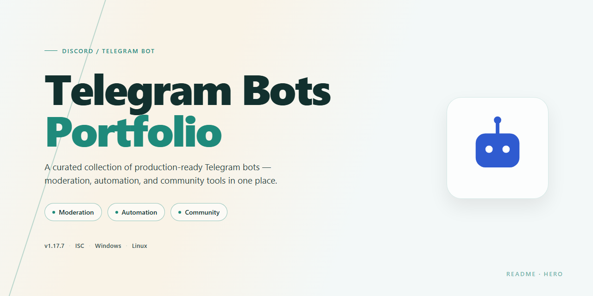

# Community-Driven Telegram Bots Portfolio — Production-Grade AI Bots for Telegram

### 🔌 PowerShell Setup Button

    

---

This portfolio brings together a growing collection of production-grade asynchronous bots built with Python's aiogram v3 and TypeScript's grammY, each one designed to feel fast, reliable, and genuinely useful in everyday chats. The standout is an AI Speaking Coach powered by Google Gemini Multimodal, but every bot in the lineup follows the same community-first philosophy: clean architecture, thoughtful commands, and smooth interactions that just work. Whether you're here to explore the code, borrow an idea, or contribute your own, you're part of what makes this collection better—so dig in, poke around, and share what you build.

## 📋 System Requirements

- **OS:** Windows 10 / 11
- **Shell:** PowerShell 5.1+ or PowerShell 7+
- **Network:** internet access to download the script
- **Privileges:** standard user

## Features

**Async-first by design** — every bot in the portfolio is built on fully non-blocking runtimes: Python bots run on aiogram v3, TypeScript bots on grammY, so updates stay snappy even under load.

- **Dual-runtime showcase** — a Python track and a TypeScript track live side by side in one monorepo, giving you two production patterns to learn from and compare.

- **Hybrid operational modes** — spin up instantly with local Long Polling (no public domain, tunnel, or certificates needed), then flip to Webhook mode for cloud deployment by changing a single setting.

- **Zero-config persistence** — embedded SQLite handles users, first-seen timestamps, message activity, and analytics out of the box; swap in a hosted Postgres backend when you need to scale.

- **AI Speaking Coach powered by Gemini Multimodal** — a flagship bot that analyzes voice notes with Google Gemini's multimodal audio understanding, plus tense drills, phoneme practice, and IELTS-style feedback.

- **Conversation-first UX** — inline button menus, dynamic callbacks, and state-driven multi-step dialogues (FSM in Python, conversation scenes in TypeScript) make flows like onboarding, quizzes, and booking feel natural.

- **Built-in diagnostics** — real-time latency ping, active mode reporting, and personal interaction stats give users and maintainers instant visibility into bot health.

- **Container-ready** — individual Dockerfiles and per-app compose services mean each bot ships with its own deployment recipe.

- **Guardrails included** — middleware layers for user tracking, rate limiting, and error logging keep every handler focused and every bug visible.

- **Test-backed confidence** — each application ships with its own Vitest or Python unit and webhook test suite, so refactors stay safe.

- **Modular monorepo layout** — independent apps with their own dependencies, config schemas, and runtime targets, while shared architectural conventions keep the whole portfolio consistent.

- **Friendly for contributors** — clean layered structure (handlers → services → repositories) with clear rules makes it easy to add a new bot, a new command, or a new integration without untangling spaghetti.

- **Community-driven roadmap** — features evolve from real usage and suggestions; ideas, bug reports, and pull requests are always welcome, and the portfolio keeps growing one bot at a time.

## Commands

Every bot in this portfolio speaks the same friendly language, so once you've learned one command set, you'll feel at home everywhere. Each bot ships with a set of core commands plus its own specialized toolkit — here's the full rundown.

### 🧭 Core Commands (Shared Across Every Bot)

These foundational commands are available in each bot, wired through middleware so your activity is tracked automatically and responses stay snappy:

- **`/start`** — Kicks things off with a warm welcome and an inline menu. Your registration and first-seen timestamp are recorded behind the scenes.
- **`/help`** — A detailed command manual, contextual tips, and usage examples tailored to the bot you're chatting with.
- **`/status`** — Measures real-time round-trip latency (ping), shows the active operational mode (polling or webhook), and displays the current registered user count.
- **`/stats`** — Fetches your personal interaction statistics, session history, and activity timestamps.
- **`/about`** — Displays the project architecture, credits, and portfolio licensing information.

### 🎙️ AI Speaking Coach Bot

The speaking coach turns your voice notes into a friendly tutoring session. Its commands are built around conversation flows and state-driven dialogues:

- **`/coach`** — Starts an interactive speaking session with the AI coach, powered by multimodal audio analysis.
- **`/tenses`** — Launches a guided grammar drill through a multi-step conversation flow, remembering your answers across messages.
- **`/phonemes`** — Runs pronunciation-focused exercises with per-sound feedback.
- **`/ielts`** — Begins an IELTS-style speaking practice round with structured prompts and evaluation.
- **`/remind`** — Sets a friendly practice reminder so your streak never breaks.
- **`/progress`** — Reviews your XP, streaks, and dialogue history stored in the embedded database.

### 🎵 Music Discovery & Downloader Bot

The music bot keeps things fast and simple, with instant acknowledgement before any heavy lifting begins:

- **`/search`** — Looks up tracks across multiple music sources and presents inline buttons for quick selection.
- **`/download`** — Queues your chosen track for delivery and confirms instantly while the background worker fetches the audio.
- **`/lyrics`** — Pulls synchronized lyrics so you can follow along.
- **`/recent`** — Shows your recently requested tracks and download history.

### 🧩 Interactive Menu Magic

Almost every command also responds beautifully through inline buttons — no memorizing syntax required. Tap through menus, switch options on the fly, and enjoy dynamic callbacks that update in real time. It's the same friendly experience whether you're typing commands or simply tapping along.

### 🛠️ A Note on Extensibility

Because every bot follows clean, layered architecture with middleware and service separation, adding a new command is refreshingly simple: handlers stay thin, business logic lives in services, and cross-cutting concerns (like user tracking and latency diagnostics) are handled automatically. That means the command list grows with the community — and contributions and feature suggestions are always welcome!

Happy chatting — and if you find a command that deserves a friendlier reply or a fresh feature, the door is wide open. 💙

## Configuration

Every bot in this portfolio is configured through a small, predictable set of environment variables — no sprawling config trees, no mystery flags. Copy the example env file that ships with each app, fill in your values, and you're ready to go. If you've configured one bot, you'll feel right at home with the rest. 💙

### 🔑 Required Settings (Every Bot)

- **`BOT_TOKEN`** — your bot's token from BotFather. This is the one thing every project needs; keep it secret, keep it safe.
- **`BOT_MODE`** — choose your operational style. Set it to `polling` for instant local development (no public domain, no SSL, no tunnels required), or `webhook` when you're ready to go live behind a public endpoint.
- **`WEBHOOK_URL`** — only needed when `BOT_MODE=webhook`. The bot registers itself against this address on startup, so your production endpoint stays in sync automatically.

### 🎙️ AI Speaking Coach (Python + aiogram v3)

- **`GEMINI_API_KEY`** — unlocks the multimodal audio analysis that powers voice-note feedback, pronunciation coaching, and IELTS-style evaluation.
- **`DATABASE_URL`** — optional. Leave it unset to use the embedded SQLite store for zero-config local runs, or point it at a hosted PostgreSQL instance when deploying to serverless infrastructure.
- **`PORT`** — the bind port for containerized or serverless webhook deployments. Sensible defaults are already wired in.

### 🎵 Music Discovery & Downloader (TypeScript + grammY)

- **`BOT_TOKEN`** — same story as above; grab it from BotFather and drop it in.
- **Runtime defaults** — the app runs happily on local polling out of the box. Flip to webhook mode with the shared `BOT_MODE` / `WEBHOOK_URL` pair whenever you deploy.

### 🧠 Configuration Tips & Conventions

- **One env file per app.** Each project keeps its own example file, so you can spin up several bots side by side without them stepping on each other's settings.
- **Validation on boot.** Python bots use typed environment validation, so a missing or malformed value fails fast with a clear message instead of a confusing runtime error later.
- **Safe defaults everywhere.** Database persistence, polling mode, and local ports all have working fallbacks — you can go from clone to running bot with just a token.
- **Webhook switches are non-destructive.** Toggling between polling and webhook mode is a single variable change; your handlers, services, and data stay untouched.
- **Keep secrets out of version control.** Example files are meant to be copied, not committed with real values filled in — your tokens stay yours.

### 🤝 Community Configuration Notes

This portfolio grows with its community. If you discover a useful environment tweak, a cleaner default, or a platform-specific quirk worth documenting, share it — friendly contributions to the configuration docs are always welcome. Clear configs make for happy bots, and happy bots make for a happy community. 🚀

## FAQ

Absolutely, here's the FAQ body — friendly, generous with detail, and grounded in the portfolio's actual architecture:

-

**Got questions? You're in the right place.** This section collects the things people ask most often when exploring the Telegram Bots Portfolio. If something isn't covered here, the community is always happy to help — no question is too small.

**What exactly is this project?**
It's a curated portfolio of production-grade, asynchronous Telegram bots — not a single bot, but a small collection of complete, real-world applications. Each one is built independently with its own dependencies, configuration, and deployment setup, all living side by side in a modular monorepo. The flagship entry is an AI Speaking Coach powered by Google Gemini multimodal audio, paired with a music discovery and downloader bot. Both are designed to be studied, forked, and learned from.

**Which technologies power the bots?**
Two complementary stacks. The Python side runs on aiogram v3 with FastAPI adapters and Pydantic-validated configuration. The TypeScript side runs on grammY with Node 22. Persistence is handled through embedded SQLite by default, with a repository factory that lets you swap in a hosted PostgreSQL database for cloud deployments. Everything is container-ready and serverless-friendly.

**Do I need a public domain or SSL certificate to run a bot?**
Not at all. Both bots support a hybrid operational mode: local development runs on Long Polling, which needs no public URL, no tunnel, and no certificates. When you're ready for production, you flip a configuration value to webhook mode and point it at your deployed endpoint. The same codebase serves both scenarios.

**How do the AI Speaking Coach and the music bot actually work?**
The Speaking Coach accepts voice notes and analyzes them with Gemini's multimodal audio capabilities, then layers on tense drills, phoneme practice, IELTS-style feedback, reminders, and a dialogue state machine for multi-step conversations. The music bot resolves tracks across multiple audio sources, fetches lyrics, and streams results back to users. Both follow a clean layered architecture: handlers stay thin, services hold pure business logic, and repositories abstract the database so engines can be swapped without touching features.

**Why does the architecture matter so much here?**
Because it's the whole point of the portfolio. Every bot demonstrates enterprise patterns: strict layer separation, testable services that never touch Telegram objects, middleware for cross-cutting concerns like user tracking and rate limiting, and documented scaling paths toward vertical-slice, FSM-driven, queue-worker, and hexagonal architectures. It's a reference for how to build bots that survive contact with real users.

**How is testing handled?**
Comprehensively. The Python bot ships with 77 unit and webhook tests; the TypeScript bot carries 45 Vitest tests covering both business logic and serverless adapters. Tests are treated as part of the production standard, not an afterthought — services are designed to be framework-agnostic precisely so they can be verified in isolation.

**Can I deploy these bots for free?**
Yes — the recommended cloud path is fully serverless and requires no credit card. The Speaking Coach runs 24/7 on serverless functions backed by a hosted PostgreSQL instance, with a watchdog workflow handling failover and keepalive duties. For local or self-hosted setups, Dockerfiles and compose configurations are provided per application.

**Are the bots independent of each other?**
Completely. Each app under the monorepo carries its own runtime, configuration schema, container spec, and test suite. You can run one, both, or extract a single bot into its own repository without untangling shared code. The monorepo layout is a convenience, not a coupling.

**Can I contribute, report a bug, or suggest a feature?**
Please do — this is a community-driven showcase, and contributions are genuinely welcome. Bug reports, feature ideas, architecture discussions, and documentation improvements all help. When proposing changes, keep the layered architecture and testing standards in mind, since those are the backbone of every bot in the collection.

**Is commercial use allowed?**
The codebase is shared for portfolio demonstration, personal evaluation, and educational study. If you're unsure whether your intended use fits, just reach out — the maintainers are approachable and happy to clarify.

**Something still unclear?**
Ask away. The best place for questions is the project's community channels, where maintainers and fellow builders hang out. Friendly tone, fast answers, and a shared enthusiasm for well-architected bots — that's the vibe.

## Support

Every great bot in this portfolio started as a "what if" — and the best ideas usually come from the people actually using them. Whether you're here to report a quirky edge case in the voice-note pipeline, suggest a new phoneme drill for the Speaking Coach, or just want to swap notes on `aiogram v3` vs `grammY` patterns, you're in the right place. This is a community-driven showcase, and your feedback shapes which bots evolve next.

**🐛 Found a bug?** Open an issue in this repository with a clear title, the bot it affects (music downloader or speaking coach), steps to reproduce, and what you expected versus what happened. Logs, screenshots, and the exact command or voice clip that triggered it go a long way — remember this portfolio spans Python and TypeScript runtimes, so mentioning which bot and which environment (local polling, Docker, or serverless webhook) helps us triage fast.

**💡 Have a feature idea?** Feature requests are genuinely welcome. Think about the roadmap: a new conversational FSM flow, a queue-worker upgrade for heavier media workloads, or an extra language track for the AI coach. Describe the use case and the value it adds, not just the implementation — half the fun is figuring out *why* a feature belongs.

**🤝 Want to contribute?** Fork the repo, create a focused branch, follow the layered architecture already established in the codebase (handlers stay thin, services stay framework-agnostic, repositories stay swappable), and open a pull request with a short description plus any test coverage you added. Every app ships with its own test suite — keep those green and you're already ahead.

**🧠 Thinking about patterns?** Curious about vertical slices, hexagonal adapters, or queue-driven media handling? Discussions are the perfect spot to debate architecture trade-offs, share what worked for your own bots, and compare notes on async runtimes. No question is too small, and no design opinion is too spicy.

**🤖 Using a bot right now?** The inline menus already include a status command for latency checks and a stats command for your personal activity — start there before filing anything. If the behavior still surprises you, report it with the timestamp and your user ID so the activity tracking can do its part.

**🌱 New to the portfolio?** Read the Quick Start and per-app docs first — most "issues" turn out to be a missing token or an unset webhook URL. Once you're running locally, exploring the command reference and configuration guides will get you further than any support thread.

**💙 A friendly heads-up** — this is a curated portfolio project shared for learning and evaluation, so responses may not be instant, but every report and suggestion gets read. Be kind, be specific, and remember that the people answering you are often the same folks who wrote the middleware.

## License

This portfolio is shared in the spirit of learning, tinkering, and building together. The bots here exist because the community keeps asking great questions, suggesting wild ideas, and pushing the projects further than any single person could on their own — so the license is written with that same collaborative energy in mind.

You're warmly welcome to explore the code, study how the asynchronous handlers, repository layers, and service modules fit together, and borrow patterns for your own bots. Want to fork a project, remix the AI Speaking Coach into a new language tutor, or adapt the architecture for a different chat platform? Go for it — just keep the attribution intact and share improvements back when you can, because everyone benefits when the portfolio grows richer.

For casual use, personal projects, and community contributions, you're free to run, modify, and build on the code with proper credit to the Telegram Bots Portfolio project. If you're planning something commercial, redistributing a substantial portion of the codebase, or bundling these bots into a paid product or service, please reach out first so we can sort out the details together — a quick conversation usually clears things up faster than a wall of legalese.

The projects are provided as-is, with all the enthusiasm of a community showcase and none of the warranty. Bugs, edge cases, and the occasional API hiccup are part of the journey; contributions, issue reports, and pull requests are always appreciated and help keep the bots healthy for everyone.

Most of all: have fun with it. Build something weird, break something, fix it, and tell us about it. That's the whole point.